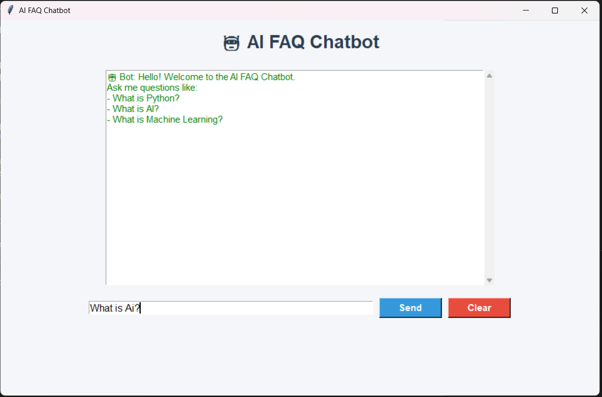
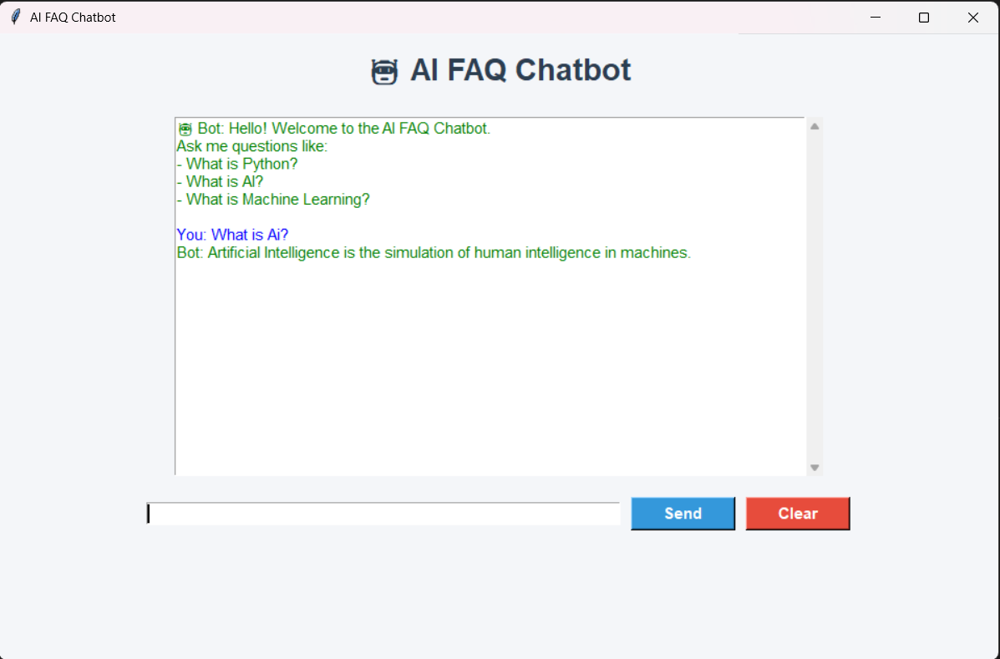

# 🤖 AI FAQ Chatbot

An AI-powered FAQ Chatbot built using Python and Tkinter. The chatbot uses Natural Language Processing (TF-IDF and Cosine Similarity) to match user questions with predefined FAQs and provide the most relevant answers.

## 🚀 Features

- GUI built with Tkinter
- AI-based question matching
- Uses TF-IDF Vectorizer
- Cosine Similarity for finding best answers
- FAQ data stored in JSON
- User-friendly interface
- Easy to customize

## 🛠️ Technologies Used

- Python
- Tkinter
- Scikit-learn
- JSON
- NumPy

## 📂 Project Structure

```
AI_FAQ_Chatbot/
│── chatbot.py
│── faq.json
│── requirements.txt
│── README.md
```

## ▶️ Installation

Clone the repository

```bash
git clone https://github.com/yourusername/AI_FAQ_Chatbot.git
```

Install dependencies

```bash
pip install -r requirements.txt
```

Run the project

```bash
python chatbot.py
```

## 📸 Screenshots




## 📌 Future Improvements

- Voice Input
- Speech Output
- Database Support
- Multiple Languages
- Deep Learning Chatbot

## 👨‍💻 Author

Aditya Kumar Pandit
